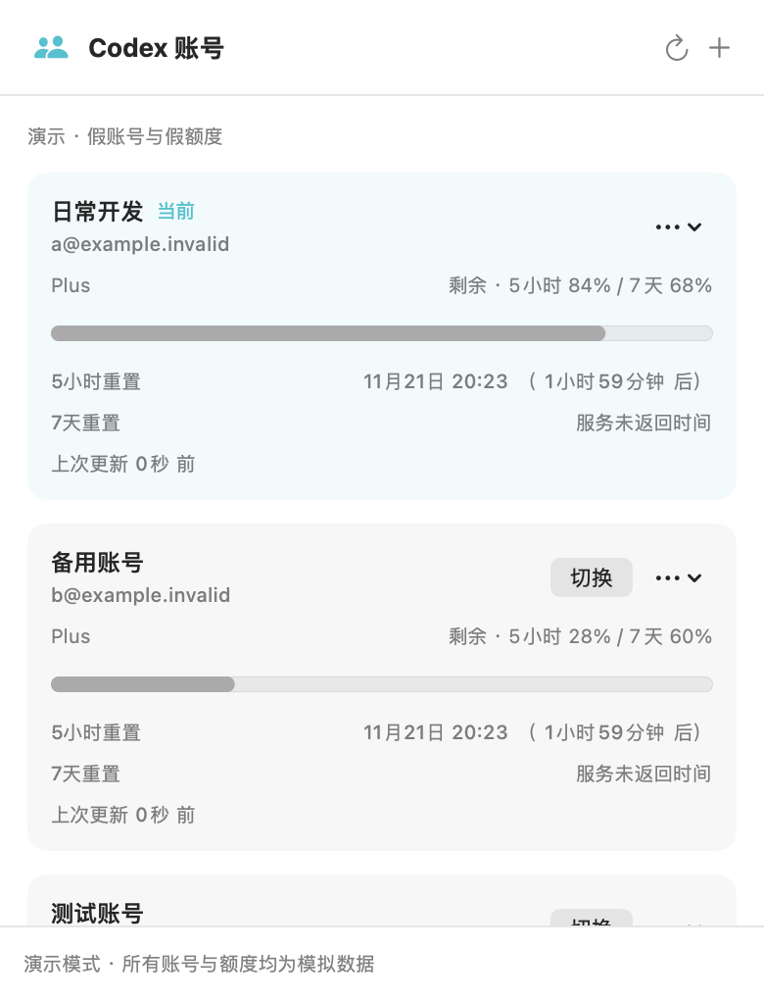

# Codex Account Switcher

English · [简体中文](README.md)

A native macOS menu bar utility for saving multiple Codex accounts, checking remaining usage and reset times, and quitting, switching, and reopening Codex after confirmation.

**Current public candidate: 0.4.6 (v0.4.6-rc.1).** Download it from Releases. Full real-account switching acceptance is incomplete. The application UI is currently in Simplified Chinese.



## Features

- Accounts, plans, remaining quota, reset dates, and countdowns in one menu bar panel.
- Add accounts through OpenAI's official browser login, including Google and Apple login. Accounts are distinguished by the account and workspace identity returned by Codex, not by email address or identity provider.
- Rename, reauthorize, or remove saved accounts; quota refresh synchronizes credentials updated by Codex for an already-saved current account.
- Show full login email addresses in the local account list to distinguish accounts. Emails are stored locally and excluded from sanitized diagnostics and public source.
- Store credentials in macOS Keychain. Background operations stop when permission is needed instead of prompting for a password.
- After explicit confirmation, validate the target, request normal Codex termination, switch, and reopen Codex. Running shared-auth CLI / IDE backends still block credential writes.
- Preserve interrupted transactions and credential generations for recovery and redacted diagnostics.

## Download and install

Download from the [v0.4.6-rc.1 pre-release](https://github.com/ru-gong/codex-account-switcher/releases/tag/v0.4.6-rc.1):

- `CodexAccountSwitcher-<version>-macOS-arm64.zip`: runnable App and bilingual installation instructions.
- `SHA256SUMS`: artifact integrity checksum.

Place both files in the same directory and run `shasum -a 256 -c SHA256SUMS`. Extract the ZIP, move `CodexAccountSwitcher.app` to Applications, and open it. The app lives in the menu bar and has no Dock window.

This build is **ad-hoc signed, without Developer ID or Apple notarization**. If macOS blocks its first launch, attempt to open it, then use System Settings → Privacy & Security → Open Anyway for this specific app. Do not disable Gatekeeper globally. [Apple's installation guidance](https://support.apple.com/en-us/102445)

Quit the previous switcher before replacing it during an upgrade. The account library is retained. A new build may require another first-launch exception or explicit Keychain authorization.

## Compatibility

| Item | Current scope |
| --- | --- |
| OS / architecture | macOS 14+; downloadable build is Apple Silicon / arm64 only |
| Codex location | `/Applications/Codex.app` |
| Codex checked with the preceding candidate | `26.1021.31345 (21828)` / backend `0.164.0-alpha.11.1`; earlier verified versions remain supported. This does not establish complete real-account switching acceptance |
| Official backend layout | New nested `CodexCLI.app` and older single-executable layouts; the desktop App and actual backend are checked separately for OpenAI signatures |
| Authentication | Default `~/.codex` directory with file credential storage |
| Automatic compatibility | OpenAI-signed versions at or above `26.903.61454 (8378)` with a recognized version format and successful operation-level protocol checks |
| Unsupported | Older or malformed versions, non-OpenAI signatures, managed authentication, non-default profiles, keyring / auto / ephemeral storage, or overridden authentication gateways |

The switcher no longer uses an exact-version allowlist. Later official versions that meet the conditions above can run directly. Usage, login, and switching perform a real isolated backend protocol check before any desktop credential write. Accounts with a prior manual continuity check reuse that record across routine Codex upgrades. If OpenAI changes the protocol, credential structure, or storage backend, the operation stops before writing and compatibility work is required then.

The new backend path is `/Applications/Codex.app/Contents/Resources/codex-cli/CodexCLI.app/Contents/MacOS/codex`. Only known paths inside the App are used; a same-named PATH executable or shell wrapper is not launched. When a quota response includes `accountId`, it must match the requested account or the result is rejected.

“额度数据待更新” means the cached result is older than 15 minutes, not that the allowance is exhausted or the login expired. Failed refreshes retain and label old values. Missing or elapsed reset times are explicit; a countdown reaching zero is not proof that quota has recovered. Invalid logins have a separate sign-in message. An explicit backend denial of included usage is displayed without inferring recovery from percentages.

## Usage

1. Choose **保存当前账号** (Save current account), then use `+` to add another account.
2. Usage refreshes automatically every 15 minutes by default. Startup, wake, and opening the menu also check for stale results. You can disable automatic refresh in **更多设置** (More settings); the preference survives relaunch. The top-right button refreshes manually. Each account shows remaining percentages, server-provided reset times, countdowns, its last update, and any failure; equal percentages across plans do not imply equal absolute allowances.
3. If permission is needed, choose **授权此账号** (Authorize this account), enter any password only in the macOS system dialog. Successful approval immediately refreshes that account. Background work never requests approval. An expired login requires signing in again; Keychain approval cannot extend token validity.
4. Save your work in Codex and quit shared-auth CLI / IDE processes. Choose **切换** (Switch) beside the target account and confirm **退出并切换** (Quit Codex and switch). The target credential is checked before normal Codex termination is requested. A refused quit, timeout, or remaining shared-auth process stops the operation without forcibly terminating processes.
5. After Codex reopens, verify the actual account and workspace, then choose **我已核对账号与工作区** (I have verified the account and workspace).

A first switch to a new account no longer requires a special launch flag. The switcher first runs an isolated protocol check for the target credential, then keeps the transaction pending until you verify the actual account and workspace in Codex and explicitly confirm it.

When Codex refreshes the current account's credentials, quota refresh synchronizes that change to the same saved account. If the current saved login has forked, use **同步当前登录** (Sync current login): the app verifies it with the official backend before saving it and retains previous credentials. Unknown accounts are not automatically added; an expired inactive account still needs **重新登录** (Sign in again). Cancellation before commit does not replace desktop credentials. Cancellation or launch failure after commit preserves the pending recovery transaction without automatic rollback or retry.

To record a separate manual continuity observation for browser state and Computer History, start acceptance mode explicitly:

```sh
open -a /Applications/CodexAccountSwitcher.app --args --live-acceptance
```

Quit an already-running switcher first. This flag **does not create isolation** and uses the current macOS user's real Codex account library. Check tasks, authenticated browser sites, and Computer History before saving the continuity observation in More settings → **验收工具** (Acceptance tools). These tools record manual observations; they do not monitor or control Computer History.

## Data, privacy, and recovery

- Normal switching replaces only `~/.codex/auth.json` through the transaction engine. It does not replace task databases, browser profiles, memories, or Computer History data.
- Credentials use the `local.codex-account-switcher.credentials.v1` Keychain service. Full login emails, aliases, quota, and transactions use `~/Library/Application Support/CodexAccountSwitcher`. Full emails are used for local display and excluded from sanitized diagnostics, public source, and distribution artifacts.
- Previously read immutable credentials are cached in process memory and cleared on sleep or session deactivation. There is no plaintext fallback credential vault.
- Login and usage communicate through the local official Codex backend. Usage queries do not pass refresh tokens to the subprocess, and the switcher does not rotate refresh tokens in the background.
- Switch progress is stored separately in `switch-attempt.json` with only stages, outcomes, timestamps, and allowlisted error codes. It contains no account IDs, email addresses, or tokens.
- Interrupted switches are not automatically replayed. Quit Codex before choosing rollback in More settings; the target account's newly refreshed credentials are retained before recovery.
- Rollback concerns authentication, not restoring an entire backup over newer tasks or browser data. The optional backup helper copies local data to an encrypted image only when explicitly run; it is separate from normal switching.

Removing the App retains the account library by default. Remove saved non-current accounts from the UI if desired. See [Privacy](docs/PRIVACY.md) for details.

## Validation and limitations

For this public candidate, all 134 Swift tests passed in both Debug and Release; all 6 synthetic subprocess scenarios passed in each configuration, all 9 release-gate tests passed, and all 4 post-startup interruption checkpoints passed. Coverage includes backend discovery, account identity, credential synchronization, quota reset times, validation before quitting, quit failures, cancellation, and recovery. This publication did not perform real-account switching or live quota queries; preceding-build live observations are recorded separately. See [Acceptance status](docs/ACCEPTANCE.md).

These checks do not establish full real-account acceptance. Round-trip switching and quota verification across two Google-login accounts and one Apple-login account remain incomplete. Menu interaction, functional restore, a 48-hour observation, and installation on another Mac are not all complete. Computer History continuity remains unverified; uninterrupted History across every account or version is not promised.

## Build and test

Requires Xcode / Swift 6 or newer and Python 3. There are no third-party Swift package dependencies.

```sh
git clone https://github.com/ru-gong/codex-account-switcher.git
cd codex-account-switcher
swift test
swift test -c release
python3 scripts/process_acceptance.py
python3 scripts/test_release_gate.py
zsh scripts/package.sh
```

Outputs are written to `dist/0.4.6/`; existing version directories are never overwritten. For synthetic-only demonstration, run `open -n dist/0.4.6/CodexAccountSwitcher.app --args --demo`.

Packaging remaps build paths, removes debug symbols, and audits artifacts. Follow [Releasing](docs/RELEASING.md) before publishing. Never upload private evidence, account files, backups, or local development history.

## Project status and license

An independent project, not an official OpenAI product. Codex itself is not bundled. No open-source license has been granted yet. See [NOTICE.md](NOTICE.md) for third-party and source notes.
