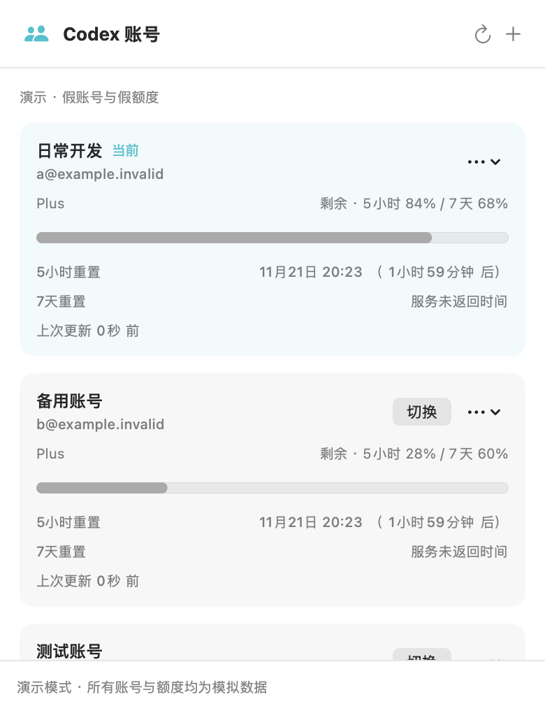

# Codex 账号切换台

[English](README.en.md) · 简体中文

一个原生 macOS 菜单栏工具，用于保存多个 Codex 账号、查看剩余额度和重置时间，并在确认后退出、切换和重开 Codex。

**当前公开候选：0.4.6（v0.4.6-rc.1）。** 可在 Releases 下载。本候选尚未完成完整真实账号切换验收。应用界面目前为简体中文。



## 功能

- 在一个菜单栏面板查看账号、套餐、各时间窗口的剩余额度、重置日期及倒计时。
- 通过 OpenAI 官方浏览器登录添加账号，支持 Google、Apple 等登录方式；以 Codex 返回的账号和工作区身份区分账号，不靠邮箱或登录提供商识别。
- 支持改名、重新登录和删除备用账号；刷新时同步已保存的当前账号在 Codex 中更新后的凭据。
- 账号列表显示完整登录邮箱，便于区分账号；邮箱保存在本机，不写入脱敏诊断或公开源码。
- 凭据保存在 macOS 钥匙串；需要系统授权时显示“待授权”，后台不主动弹密码窗口。
- 确认“退出并切换”后，先校验目标账号，再请求正常退出 Codex，切换后自动重开；仍在运行的共享认证 CLI / IDE 会阻止写入。
- 切换中断时保留事务和凭据代次，支持检查后回退及脱敏诊断。

## 下载与安装

从本仓库 [v0.4.6-rc.1 预发布](https://github.com/ru-gong/codex-account-switcher/releases/tag/v0.4.6-rc.1) 下载：

- `CodexAccountSwitcher-<版本>-macOS-arm64.zip`：可运行的 App 及中英文安装说明。
- `SHA256SUMS`：文件完整性校验。

把两者下载到同一目录，可执行 `shasum -a 256 -c SHA256SUMS` 校验。解压 ZIP，将 `CodexAccountSwitcher.app` 拖到“应用程序”，然后打开；图标显示在菜单栏，不显示 Dock 窗口。

本包使用本地 ad-hoc 签名，**没有 Developer ID，也未经 Apple 公证**。若首次启动被拦截，先尝试打开，再在“系统设置 → 隐私与安全性”中为本 App 选择“仍要打开”。这是 Apple 提供的单应用允许流程，不需要全局关闭 Gatekeeper。[Apple 安装说明](https://support.apple.com/zh-cn/102445)

升级前先退出旧切换台，再替换 App。账号库默认保留。新构建可能再次需要首次打开许可或一次钥匙串显式授权。

## 兼容范围

| 项目 | 当前范围 |
| --- | --- |
| 系统与架构 | macOS 14+，当前成品仅 Apple Silicon / arm64 |
| Codex 安装位置 | `/Applications/Codex.app` |
| 前一候选核验 Codex | `26.1021.31345 (21828)`（后端 `0.164.0-alpha.11.1`）；保留先前已核验版本，核验不等于完整实机换号验收 |
| 官方后端位置 | 支持新版内嵌 `CodexCLI.app` 及旧版单文件布局；分别验证桌面 App 和实际后端的 OpenAI 签名 |
| 认证存储 | 默认 `~/.codex`，file 后端 |
| 自动兼容范围 | OpenAI 官方签名、版本不低于 `26.903.61454 (8378)`、版本号格式可识别，并通过操作前协议检查 |
| 不支持 | 更旧或格式未知的版本、非官方签名、受管认证、非默认 profile、keyring / auto / ephemeral 后端或认证网关覆盖 |

程序不再使用逐版本白名单。符合上述条件的后续官方版本可直接运行；额度查询、登录和切换会在写入桌面凭据前使用隔离的官方后端完成真实协议检查。已经人工核验过连续性的账号可沿用记录，无需在每次 Codex 小版本更新后重新解锁。若 OpenAI 改变协议、认证文件结构或凭据后端，操作会在写入前停止，此时才需要重新适配。

新版后端路径为 `/Applications/Codex.app/Contents/Resources/codex-cli/CodexCLI.app/Contents/MacOS/codex`。工具只选择已知的 App 内路径，不运行 PATH 中的同名程序或 shell 包装脚本。额度响应提供 `accountId` 时必须与请求的账号一致，否则拒绝显示该结果。

“额度数据待更新”只表示缓存超过 15 分钟，不表示额度用完或登录过期。查询失败会保留并标记旧值；重置时间缺失或已经到期时，会明确提示，不能把倒计时结束视为额度已经恢复。真正的登录失效会单独提示重新登录。新版后端明确返回不允许使用包含额度时，会显示该状态，不根据百分比推断恢复。

## 使用

1. 首次打开后点“保存当前账号”，再通过右上角 `+` 添加备用账号。
2. 默认每 15 分钟自动刷新额度，启动、唤醒和打开面板时会补查过期结果；“更多设置”可关闭，设置会在重启后保留。右上角按钮可手动刷新，每个账号显示剩余百分比、服务端重置时间、倒计时、上次更新时间与失败原因。相同百分比不代表不同套餐的相同绝对额度。
3. 需要钥匙串授权时，点击该账号的“授权此账号”，只在 macOS 系统窗口输入密码，授权成功会立即更新该账号额度。后台不弹授权窗口；若显示“登录已过期”，需重新登录，钥匙串授权不能延长令牌有效期。
4. 保存 Codex 中的工作，并退出共享登录的 CLI / IDE。点击目标账号的“切换”，确认“退出并切换”。工具先校验目标凭据，再请求正常退出 Codex；若拒绝退出、等待超时或仍有共享认证进程，会停止，不强制结束进程。
5. 自动重开 Codex 后核对实际账号与工作区，再回切换台点“我已核对账号与工作区”。

新账号首次切换不再需要专用启动参数。切换台会先对目标凭据执行隔离协议检查，写入后保持待确认状态；只有你在 Codex 中核对实际账号和工作区并点击确认，事务才会结束。

Codex 自动刷新了当前账号凭据时，刷新额度会把变化同步回已保存的同一账号。如当前账号出现凭据分叉，可点击“同步当前登录”；程序会先用官方接口验证，再保存当前登录并保留旧凭据。未知账号不会因此自动加入列表；备用账号若已过期，仍需通过“重新登录”更新。取消发生在提交前不会替换桌面凭据；提交后的取消或重开失败会保留待恢复事务，不自动回滚或重试。

如需另外记录浏览器和 Computer History 的人工连续性观察，可显式启动验收模式：

```sh
open -a /Applications/CodexAccountSwitcher.app --args --live-acceptance
```

若程序已运行，先退出再执行。`--live-acceptance` **不创建隔离环境**，会使用当前系统用户的真实 Codex 账号库。核验任务、已登录浏览器站点和 Computer History 后，可在“更多设置 → 验收工具”保存连续性核验记录。验收工具仅记录人工观察，不监测或控制 Computer History。

## 数据、隐私与恢复

- 普通账号切换仅受控替换 `~/.codex/auth.json`，不切换或覆盖任务数据库、浏览器 profile、记忆或 Computer History 数据。
- 账号凭据存于 Keychain 服务 `local.codex-account-switcher.credentials.v1`；完整登录邮箱、别名、额度和事务存于 `~/Library/Application Support/CodexAccountSwitcher`。完整邮箱用于本机显示，不包含在脱敏诊断、公开源码或分发成品中。
- 已读取的不可变凭据会在进程内缓存；休眠或用户会话失活时清空。没有钥匙串凭据的明文回退库。
- 登录和额度通过本地官方 Codex 后端通信。额度查询不向子进程传递 refresh token；工具不会在后台主动轮换 refresh token。
- 切换进度另存为 `switch-attempt.json`，只记录阶段、结果、时间及允许列表中的错误码，不记录账号 ID、邮箱或令牌。
- 中断后不会自动重试切换。需要回退时，先退出 Codex，再使用“更多设置 → 退出 Codex 后回退”；回退前保留目标账号启动后的新凭据代次。
- 回退针对认证，不会用整目录备份覆盖新任务或浏览器数据。可选的备份辅助脚本会按用户主动操作复制本地数据到加密镜像，它与日常切换是独立流程。

卸载 App 默认保留账号库；需要移除备用账号时可先在工具内删除。详细边界见 [隐私说明](docs/PRIVACY.md)。

## 当前验证与限制

本次公开候选的 134 项 Swift 自动测试在 Debug、Release 配置均通过，两个配置的 6 项模拟进程验收均通过，发布门槛测试 9 项通过，启动后中断恢复的 4 个检查点通过。覆盖后端发现、账号身份、凭据同步、额度重置时间、切换前验证、退出失败、取消与恢复状态。未在本次发布中执行真实账号切换或在线额度查询；前一候选的实机记录单独保留。详见[验收状态](docs/ACCEPTANCE.md)。

这些结果不代替真实账户验收。两个 Google 登录账号和一个 Apple 登录账号的完整往返切换及额度核对尚未验收完成；完整菜单操作、功能恢复、48 小时观察和另一台 Mac 安装也尚未全部完成。Computer History 的持续运行仍待验证，不能承诺每个账号或每个版本的 History 都不中断。

## 构建与测试

需要 Xcode / Swift 6 以上和 Python 3。本项目没有第三方 Swift 包依赖。

```sh
git clone https://github.com/ru-gong/codex-account-switcher.git
cd codex-account-switcher
swift test
swift test -c release
python3 scripts/process_acceptance.py
python3 scripts/test_release_gate.py
zsh scripts/package.sh
```

产物位于 `dist/0.4.6/`，同版本目录已存在时拒绝覆盖。`open -n dist/0.4.6/CodexAccountSwitcher.app --args --demo` 使用临时假账号库演示，不连接真实账号。

打包会重映射构建路径、去除调试符号并扫描成品。发布前请执行 [发布与隐私检查流程](docs/RELEASING.md)，不要上传自己的 `evidence/`、账号文件、备份或本机开发历史。

## 项目性质与许可

独立项目，非 OpenAI 官方产品，不包含 Codex 本体。目前未另行授予开源许可。第三方与来源说明见 [NOTICE.md](NOTICE.md)。
